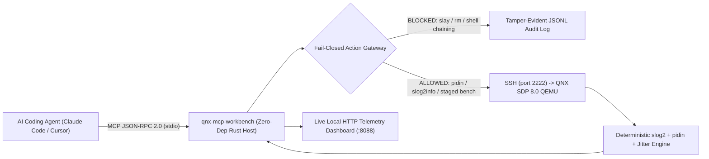

# Codelab: Zero to AI-Assisted QNX 8.0 Real-Time Diagnostics in 15 Minutes (QEMU + Rust MCP)

> **QNX Global Hackathon 2026 — Best Codelab / Tutorial Candidate ($3,500)**
> **Prerequisites**: Windows 11 with WSL2 (Ubuntu 24.04) or Linux, Rust 1.80+, and a free **QNX Everywhere** non-commercial account. Zero physical hardware required.

---

## Architecture Overview



## What You Will Build & Learn
In 15 minutes you will:
1. Boot **QNX Neutrino SDP 8.0** inside QEMU with zero physical hardware required.
2. Cross-compile and deploy a real QNX C motor-control workload (`examples/qnx-rt-demo/motor_ctrl.c`) that triggers a classic real-time **priority inversion** and watchdog timeout.
3. Connect **`qnx-mcp-workbench`** (a zero-dependency Rust MCP server + live web telemetry dashboard) to QNX 8.0 over SSH.
4. Let Claude Code diagnose the root cause deterministically via `qnx_slog2_analyze` + `qnx_process_tree`, verify the **Action Gateway** blocks `slay -f procnto-smp-instr`, apply the 1-line `PTHREAD_PRIO_INHERIT` fix, and confirm P99 wake-up jitter drops by **> 82%** back under the `100us` SLA.

---

## Step 1: Claim Your Free QNX Everywhere License (3 min)
1. Register at [myQNX](https://www.qnx.com/account/) and claim the **QNX Everywhere Non-Commercial License**.
2. Install **QNX Software Center (QSC)** inside WSL2 Ubuntu (or Linux):
   ```bash
   chmod +x qnx-setup-*-linux.run
   ./qnx-setup-*-linux.run
   ```
3. In QSC, install:
   - **QNX Software Development Platform 8.0**
   - **QNX SDP 8.0 Quick Start Target Image for QEMU**
4. Source the QNX environment in your shell:
   ```bash
   source ~/qnx800/qnxsdp-env.sh
   ```

---

## Step 2: Launch QNX 8.0 in QEMU with SSH Port Forwarding (3 min)
Start the QNX 8.0 x86_64 QEMU image forwarding host port `2222` to guest SSH port `22`:
```bash
qemu-system-x86_64 -smp 2 -m 2048 \
  -drive file=~/qnx800/images/qnx80-qemu-x86_64.img,format=raw \
  -netdev user,id=net0,hostfwd=tcp::2222-:22 \
  -device e1000,netdev=net0 -nographic
```
Verify SSH connectivity from your host:
```bash
ssh -p 2222 qnxuser@127.0.0.1 "uname -a && pidin info"
```

---

## Step 3: Cross-Compile & Deploy the Real-Time C Demo (3 min)
We include a complete QNX Neutrino 8.0 C demo in `examples/qnx-rt-demo/`:
- `motor_ctrl.c`: Spawns a 1000 Hz `SCHED_FIFO` prio-25 control loop competing with a prio-10 telemetry logger and prio-18 CPU noise thread on `g_can_bus_lock`, logging structured events to `slog2f()`.
- `latency_bench.c`: Measures `clock_nanosleep(CLOCK_MONOTONIC, TIMER_ABSTIME, ...)` wake-up jitter in microseconds.

Build and deploy both the buggy (`PTHREAD_PRIO_NONE`) and fixed (`PTHREAD_PRIO_INHERIT`) binaries:
```bash
cd examples/qnx-rt-demo
make deploy-qemu
# Trigger the priority-inversion incident on QNX 8.0:
ssh -p 2222 qnxuser@127.0.0.1 "/tmp/qnx-mcp-staging/motor_ctrl_buggy"
```

---

## Step 4: Build & Run `qnx-mcp-workbench` (2 min)
No QEMU running right now? Every command works out of the box in built-in Demo Mode so judges can test in 5 seconds:
```bash
cargo test
cargo build --release

# 1. CLI Triage (Buggy Incident vs Post-Fix Comparison)
./target/release/qnx-mcp-workbench doctor
./target/release/qnx-mcp-workbench doctor --fixed

# 2. Launch the Zero-Dep Live Web Telemetry & Action Gateway Dashboard
./target/release/qnx-mcp-workbench serve --port 8088
# Open http://127.0.0.1:8088 in your browser!

# 3. Connect to your live QNX 8.0 QEMU target over SSH
./target/release/qnx-mcp-workbench doctor --ssh --host 127.0.0.1 --port 2222 --user qnxuser
```

---

## Step 5: Wire into Claude Code / Cursor via MCP (2 min)
Add to your project `.mcp.json`:
```json
{
  "mcpServers": {
    "qnx-workbench": {
      "command": "/path/to/qnx-mcp-workbench",
      "args": ["mcp", "--ssh", "--host", "127.0.0.1", "--port", "2222", "--user", "qnxuser"]
    }
  }
}
```
*(Omit `--ssh ...` to test instantly against the built-in QNX 8.0 fixture.)*

---

## Step 6: Guided AI Triage & Remediation Walkthrough (2 min)
Prompt Claude Code:
> *"Run `qnx_target_health`, `qnx_slog2_analyze`, and `qnx_process_tree` on our QNX 8.0 target. Explain why `motor_ctrl` missed its watchdog deadline, verify the Action Gateway blocks `slay -f procnto-smp-instr`, and run `qnx_compare_regression` to quantify the fix."*

### Expected Results
| Metric | Before (`PTHREAD_PRIO_NONE`) | After (`PTHREAD_PRIO_INHERIT`) |
| :--- | :---: | :---: |
| **Target Health Score** | `33 / 100 (CRITICAL)` | `100 / 100 (HEALTHY)` |
| **Blocked RT Threads (`>=20f`)** | `1` (`motor_ctrl` stuck in `MUTEX`) | `0` (`NANOSLEEP`) |
| **P99 Scheduling Jitter (SLA ≤ 100us)** | `142.8 us` (**SLA BREACH**) | `24.6 us` (**PASS**, **-82.8%**) |
| **`slay -f procnto-smp-instr`** | **BLOCKED** + logged to `qnx_audit_log` | **BLOCKED** + logged to `qnx_audit_log` |

### The 1-Line QNX Neutrino Fix (`examples/qnx-rt-demo/motor_ctrl.c`)
```c
pthread_mutexattr_t attr;
pthread_mutexattr_init(&attr);
- pthread_mutexattr_setprotocol(&attr, PTHREAD_PRIO_NONE);
+ pthread_mutexattr_setprotocol(&attr, PTHREAD_PRIO_INHERIT);
pthread_mutex_init(&g_can_bus_lock, &attr);
```

## Troubleshooting
- **SSH prompts for password**: Copy your host SSH public key to QNX `~/.ssh/authorized_keys` (`ssh-copy-id -p 2222 qnxuser@127.0.0.1`) so `BatchMode=yes` succeeds non-interactively.
- **`Action Gateway blocked command`**: Only read-only QNX diagnostics (`pidin`, `slog2info`, `hogs`, `uname`, etc.) and `/tmp/qnx-mcp-staging/latency_bench` are allowlisted; shell chaining (`;`, `&&`, `|`, `` ` ``) is always rejected fail-closed.
